# omnicam (rpi-omni-cam)

A pocket camera that handles like a small DSLR, built from a **Raspberry Pi Zero 2 W**,
a **Raspberry Pi camera** and a **Pimoroni Display HAT Mini**: live colour
preview, P / A / S / M exposure modes, a quick menu, bracketing and burst,
focus aids, filters, timelapse, on-camera playback, and USB export of your photos
— all driven by four buttons.

<p align="center">
  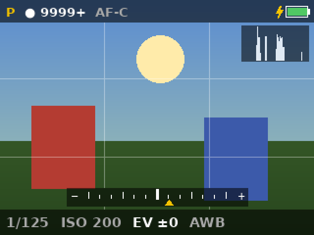
  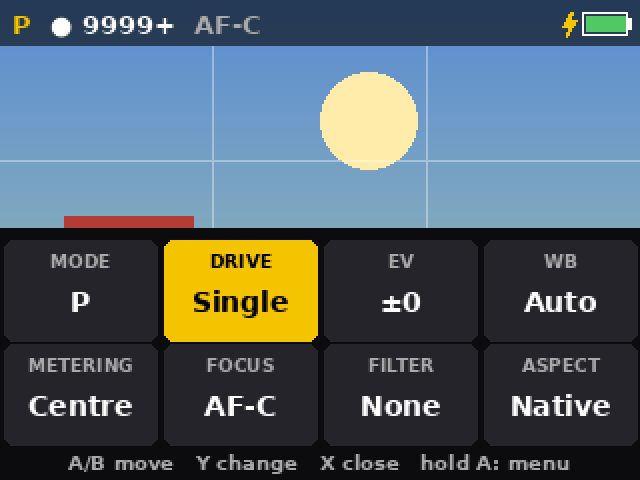
</p>

## Features

- **Live view** with exposure meter, histogram, grid (thirds / diagonals), focus
  peaking, highlight warning (zebras) and a 2× / 4× focus magnifier
- **Exposure modes** P, A, S, M (Sony naming); shutter 1/4000 – 1 s, ISO 100 – 1600+
  (depends on the sensor), exposure compensation ±2 EV, metering
  centre-weighted / spot / matrix
- **Drive modes** single, burst ×5 / ×10, exposure bracketing (3 or 5 frames),
  self-timer, timelapse with exposure lock
- **Image** full-resolution JPEG with EXIF, optional RAW (DNG), image size L/M/S,
  aspect ratio native / 4:3 / 3:2 / 16:9 / 1:1, picture style (sharpness,
  contrast, saturation, noise reduction), filters (B&W, Sepia, High Contrast,
  Vivid, Cool, Warm, Vintage)
- **Autofocus** AF-C / AF-S / manual focus on autofocus cameras (Camera Module 3)
- **Quick menu** for the eight most-used settings, and a **tabbed full menu**
  with in-place editing and a help line
- **Playback** with 100 % zoom and delete; **USB export** — the camera shows up
  as a drive on your computer over the micro-USB port
- **Standby** (hold Y 3 s), battery level, and a desktop **simulator** for development

## Screenshots

*Taken with the built-in simulator (synthetic scene); regenerate with
`scripts/screenshots.py`.*

| | | |
|:-:|:-:|:-:|
| 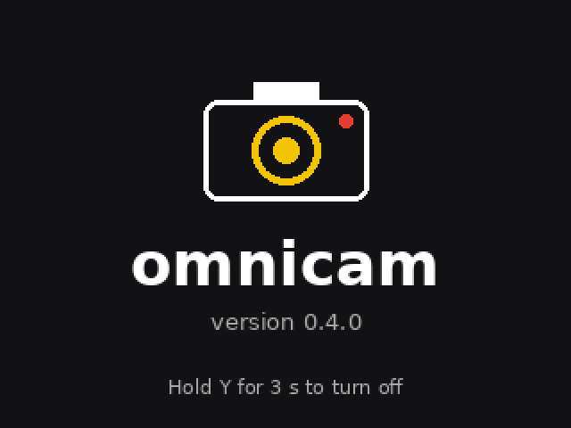<br>Welcome (after holding Y) | <br>Live view: grid, histogram, meter | 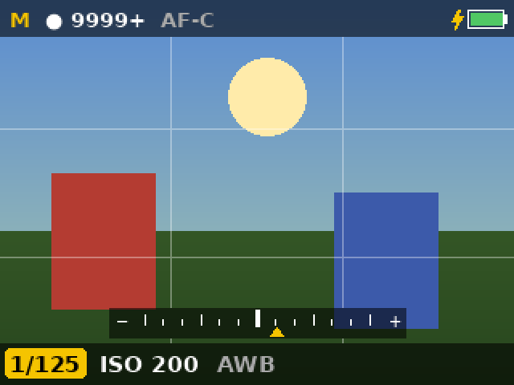<br>M mode, adjusting the shutter (Y) |
| <br>Quick menu (A) | 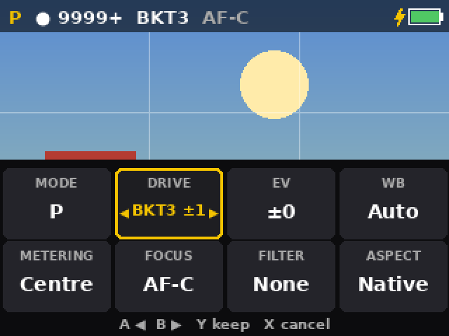<br>Changing a tile in place | 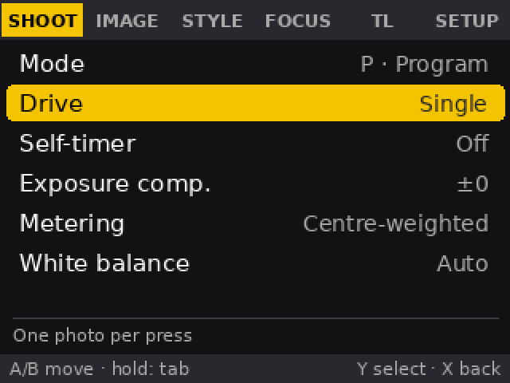<br>Full menu (hold A), CAM tab |
| 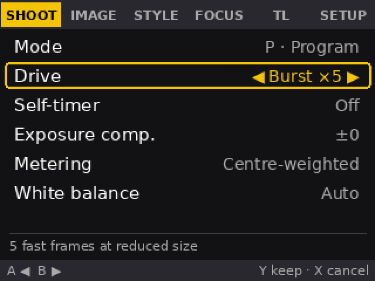<br>In-place editing with help line | 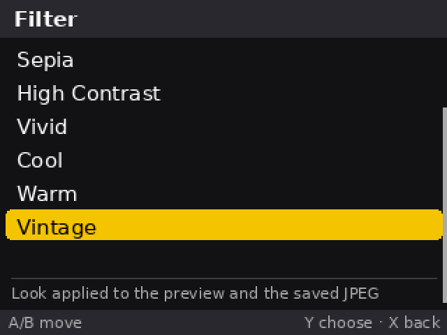<br>Picker for long lists | 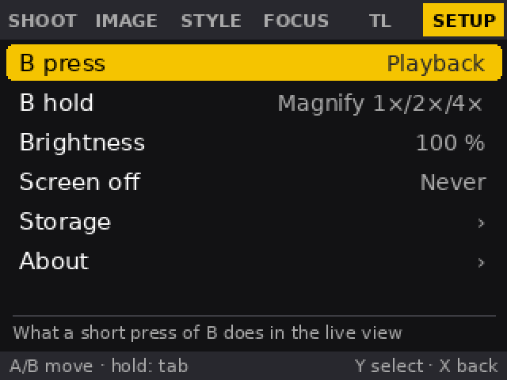<br>SETUP tab |
| 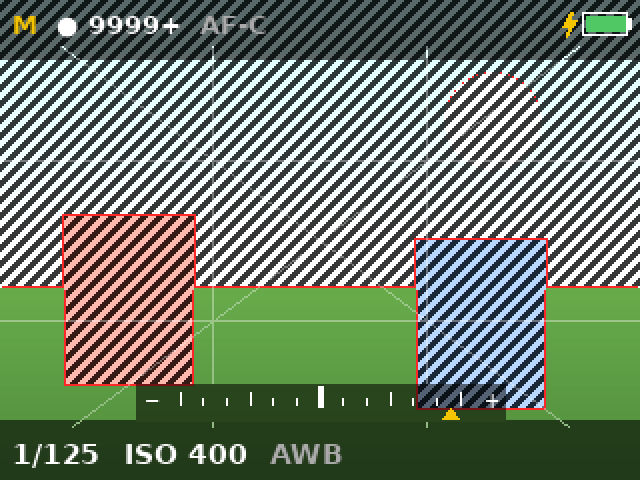<br>Peaking, zebras, 16:9 guides, diagonals | 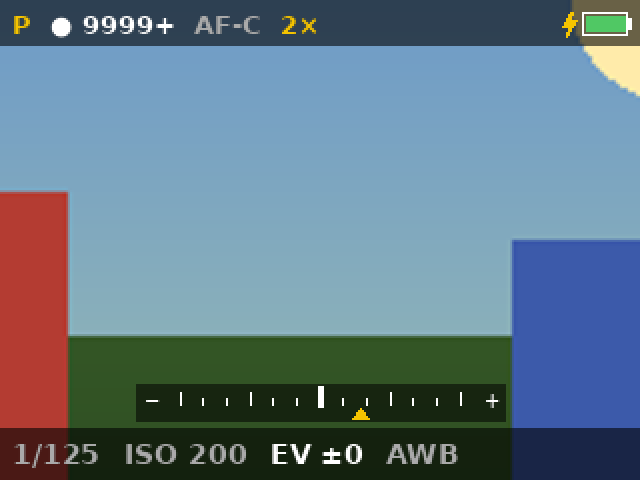<br>Focus magnifier 2× | 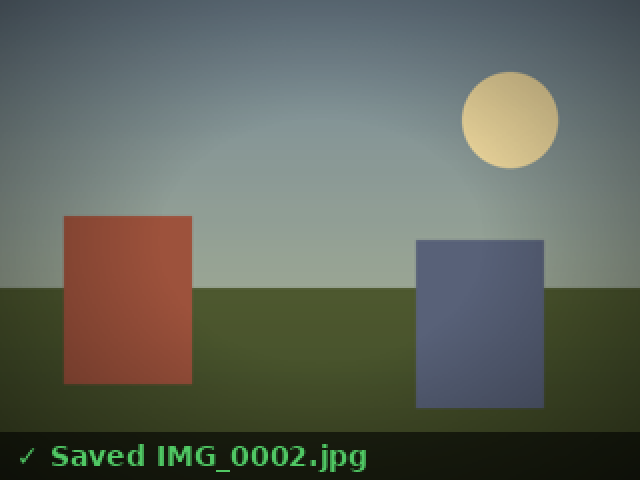<br>Review after a shot (Vintage filter) |
| 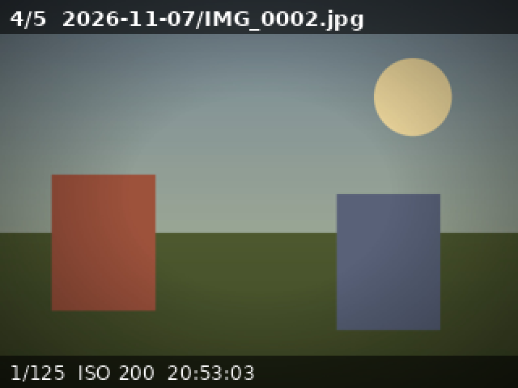<br>Playback | 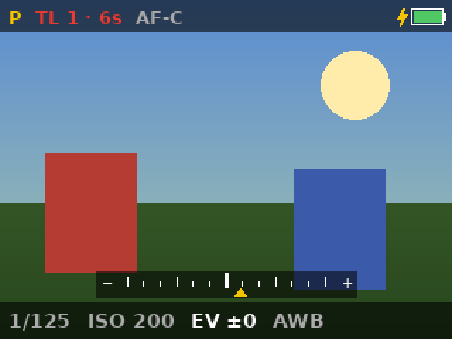<br>Timelapse running | 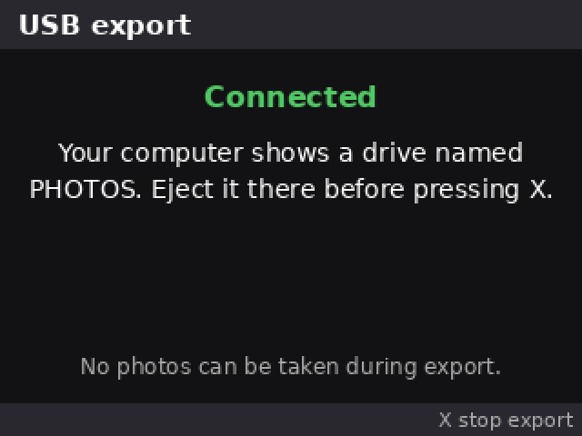<br>USB export |
| 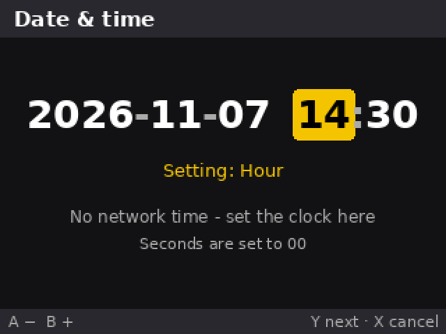<br>Setting the date and time | 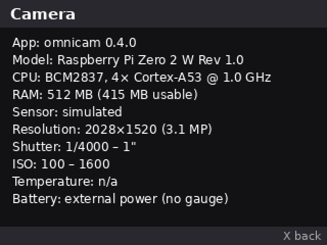<br>Camera info | |

## Hardware

| Part | Notes |
|------|-------|
| Raspberry Pi Zero 2 W | Raspberry Pi OS (Bookworm or later; developed on Trixie) |
| Raspberry Pi camera | v2, v3 or HQ — the sensor and its limits are detected at runtime |
| Pimoroni Display HAT Mini | 320×240 LCD, buttons A/B/X/Y, RGB LED |
| microSD card | 16 GB or more |
| Battery board (optional) | PiSugar, or an INA219-based UPS HAT such as the Waveshare UPS HAT (C) |
| 3D printed case | |

## Setup

1. Flash **Raspberry Pi OS Lite** with Raspberry Pi Imager (set up Wi-Fi/SSH as
   you like) and boot the Pi.
2. Install:
   ```bash
   git clone <this repo> ~/rpi-omni-cam
   cd ~/rpi-omni-cam
   sudo ./scripts/install.sh      # or: sudo PHOTOS_SIZE_GB=8 ./scripts/install.sh
   sudo reboot
   ```
   `install.sh` installs `picamera2` and the display driver, configures SPI for
   the Display HAT Mini and USB device mode in `config.txt`, creates the photo
   storage (see [Photos](#photos-and-usb-export)) and enables the `omnicam`
   service, which starts the camera at boot.
3. The camera boots into **standby** (screen dark). **Hold Y for 3 seconds** to
   turn it on.

## Using the camera

### Buttons

```
        ┌──────────────────────────────┐
   A ── │                              │ ── X   shutter        (hold: timelapse)
        │        Display HAT Mini      │
   B ── │                              │ ── Y   adjust exposure (hold 3 s: on/off)
        └──────────────────────────────┘
```

| Button | Live view | Menus and playback |
|--------|-----------|--------------------|
| **A** | quick menu · **hold:** full menu | move up / previous · **hold:** jump |
| **B** | function · **hold:** second function | move down / next · **hold:** jump |
| **X** | take photo · **hold:** start / stop timelapse | back · close · cancel |
| **Y** | adjust exposure · **hold 3 s:** off | choose · confirm · change |

The rule everywhere: **Y** chooses, **X** goes back, **A/B** move (or change a
value while editing).

**On / off:** the camera starts in standby when the Pi boots. Hold **Y** for
3 s to turn it on (welcome screen, then live view). To turn it off, hold **Y**
for 3 s **in the live view** (screen dark, camera stopped, settings saved); on
other screens — menus, playback, dialogs — holding Y never powers off. This is a
standby — **Menu › SETUP › About › Shut down** powers the Pi off.

### The live view

- **Top bar:** mode (P/A/S/M), shots left, drive (BURST5, BKT3…), self-timer,
  RAW, focus mode (AF-C / AF-S), magnifier (2×), a red **RAM** if photos are
  only kept in memory, a red **HOT** above 80 °C, and the battery on the right.
- **Bottom bar:** shutter speed, ISO, exposure compensation, manual focus
  distance, white balance and filter. **White** values are set by you; **grey**
  values are what auto-exposure is currently using.
- **Meter:** above the bottom bar, from −2 to +2 EV; the bold centre mark is a
  correct exposure.
- Optional overlays: grid, histogram, focus peaking, highlight warning, and
  shading for a non-native aspect ratio.

### Exposure modes and adjusting

Choose the mode in the quick menu (first tile) or **Menu › CAM › Mode**.

| Mode | Shutter | ISO | Y steps through |
|------|---------|-----|-----------------|
| **P** program | auto | auto | EV |
| **A** aperture priority | auto | set | ISO → EV |
| **S** shutter priority | set | auto | shutter → EV |
| **M** manual | set | set | shutter → ISO |

Press **Y** to start adjusting: the first value is highlighted and **A / B** step
it up / down (hold to repeat; values stop at the ends of their range). **Y**
moves to the next value; after the last one, adjusting ends. It also ends after
5 s without a press, or when you press **X** to shoot. With manual focus on an
autofocus camera, focus distance is added (A = closer, B = farther).

EV (exposure compensation) makes auto-exposure darker or brighter. In **A** you
set the aperture on the lens ring (HQ camera; the other Pi cameras have a fixed
aperture) and the ISO with A/B; the camera picks the shutter speed.

### Quick menu (A)

Eight tiles over the bottom of the live view: **Mode, Drive, EV, WB, Metering,
Focus, Filter, Aspect**. **A / B** move between tiles; **Y** changes the
highlighted one in place (`◀ value ▶`) — the live view updates at once — then **Y**
keeps the new value or **X** cancels back to the old one. **X** closes the quick
menu, **hold A** opens the full menu. It reopens on the tile you used last.

### Full menu (hold A)

| Tab | Items |
|-----|-------|
| **CAM** | Mode, Drive, Self-timer, Exposure comp., Metering, Long exposures |
| **IMG** | Filter, White balance, Image size, Aspect ratio, JPEG quality, Save RAW |
| **STYLE** | Sharpness, Contrast, Saturation, Noise reduction |
| **FOCUS** | Focus mode, Focus peaking, Highlight warning, Grid, Histogram |
| **VID** | Video size, Slow-motion speed |
| **TL** | Interval, Shots, Exposure lock, Make video, Video speed, Start timelapse |
| **SETUP** | **Wi-Fi & Remote ›**, **Custom sets ›**, **Controls ›** (B press, B hold, Left-handed, Upside down), **Display ›**, **Storage ›**, **System ›** (Date & time, Camera info, Reset settings, Shut down) |

- **A / B** move through the items; past the end of a tab you continue into the
  next one. **Hold A / B** to jump a whole tab.
- **Y** on a setting: On/Off settings flip; short lists change in place
  (`◀ value ▶`, arrows turn grey at the ends; **Y** keeps, **X** cancels); long
  lists (Filter, Interval, Shots, B press/hold) open a picker.
- **Y** on an action runs it; on a page (marked ›) it opens that page.
- **X** goes back. The help line at the bottom explains the highlighted item or
  value. The menu reopens where you left it.

### Function button (B)

B has two functions: one for a **press** (default **Playback**) and one for a
**hold** of 0.7 s (default **Magnify**), set in **Menu › SETUP › B press / B hold**.
Choices: Playback, Magnify (1× → 2× → 4×), Drive, Filter, White balance, Mode,
Metering, Focus mode, Focus peaking, Self-timer, Grid (each press cycles),
Highlight warning, Histogram (on/off), Timelapse start/stop, USB export — and
*None* for the hold.

The **magnifier** crops the live view on the sensor (so it stays sharp) to check
focus, and returns to 1× when you take the photo.

### Date and time

The Pi has no clock battery: without a network it can't get the time, so photo
dates and folder names would be wrong. **Menu › SETUP › Date & time** sets the
clock: **A / B** change the highlighted field (hold to repeat), **Y** moves
year → month → day → hour → minute and saves on the last field, **X** cancels.
Seconds are set to 00. The screen says whether the clock is currently synced
from the network; when the camera is online, network time takes over again. The
time is also recorded where the OS restores the clock from at boot, so after a
reboot without network it continues from roughly where it was.

### Playback

**A / B** previous / next (newest first) · **Y** 100 % zoom · **hold Y** delete
(asks first; a timelapse is one entry and is deleted as a whole) · **X** back
(out of zoom, then to the live view).

### LED

Red while capturing, green flash when saved, amber blinks during the
self-timer, blue blink per timelapse frame, dim white while you hold Y in standby.

## Shooting features

| Option | Choices | Notes |
|--------|---------|-------|
| Drive | Single · Burst ×5 / ×10 · Bracket 3 ±1 EV / 3 ±2 EV / 5 ±1,2 EV | Burst is fast at ≈ ¼ resolution. Bracketing centres on the current exposure, changes the shutter first and the ISO past the 1 s limit, and holds white balance. |
| Metering | Centre-weighted · Spot · Matrix | The on-screen meter follows it. |
| Focus mode | AF-C · AF-S · MF | Autofocus cameras only; AF-S focuses when you press X. |
| Picture style | Sharpness, Contrast, Saturation: Low / Normal / High · Noise reduction: Off / Fast / High quality | Noise reduction applies to saved photos. |
| Image size | L (full) · M (≈ ½ the pixels) · S (≈ ¼) | |
| Aspect ratio | Native · 4:3 · 3:2 · 16:9 · 1:1 | Centre crop; the live view shades what will be cut. |
| Filter | None, B&W, Sepia, High Contrast, Vivid, Cool, Warm, Vintage | Shown live and saved into the JPEG (RAW stays unfiltered). |
| Timelapse | Interval 1 s – 1 h · Shots 10 – 1000 or unlimited · Exposure lock | Frames go in their own folder. |

Unsupported camera controls (e.g. autofocus on a Camera Module 2) are skipped
automatically.

## Photos and USB export

Photos are saved on the SD card inside a FAT32 disk-image file,
`/var/lib/omnicam/photos.img`, mounted at `/media/photos`. `install.sh` gives it
half the free space (at most 32 GB) unless you set `PHOTOS_SIZE_GB`. It's an image
rather than a folder because USB storage mode shares a whole disk, not a folder.

```
DCIM/2026-11-07/IMG_0001.jpg
DCIM/2026-11-07/IMG_0001.dng            (if RAW is on)
DCIM/2026-11-07/TL_0001/FRAME_00001.jpg (timelapse)
```

**USB export:**

1. **Menu › SETUP › Storage › USB export** (or put USB export on the B button).
2. Connect the Pi's **USB data port** — the inner micro-USB marked `USB`, not
   `PWR IN` — to a computer with a data cable. A drive named **PHOTOS** appears;
   the computer can also power the camera through this port.
3. Copy or delete photos, then **eject** the drive on the computer.
4. Press **X** on the camera. It checks (and if needed repairs) the drive, mounts
   it again and returns to the live view.

The camera can't shoot during export — two writers on one drive would corrupt it.

**Timelapse to video** on your computer:

```bash
ffmpeg -framerate 25 -i DCIM/2026-11-07/TL_0001/FRAME_%05d.jpg -c:v libx264 -pix_fmt yuv420p timelapse.mp4
```

**No photo storage?** If the image isn't mounted, the camera still works but keeps
photos **in RAM only** (`/dev/shm/omnicam-photos`) — they are **lost at
power-off**. The top bar shows a red **RAM** and shutting down warns you. RAM
storage is capped at 128 MB and always leaves 192 MB free for capturing.

## Battery

The battery level is shown top right when a supported gauge is found:
**PiSugar** (needs `pisugar-server`), INA219-based UPS HATs such as the
**Waveshare UPS HAT (C)** (I2C 0x43; charge estimated from voltage), or any
battery Linux lists in `/sys/class/power_supply`. Without a gauge the camera
assumes external USB power and shows a full green battery with a charge bolt.
Below 15 % the icon turns red. Temperature and the detected battery source are in
**Menu › SETUP › About › Camera info**.

## Service

```bash
sudo systemctl status omnicam
journalctl -u omnicam -f            # logs buttons, captures, errors
sudo systemctl restart omnicam
```

Settings are kept in `/var/lib/omnicam/settings.json`; **Menu › SETUP › About ›
Reset settings** restores the defaults (photos are untouched).

## Development (no Pi needed)

```bash
python3 -m venv .venv && .venv/bin/pip install -r requirements-dev.txt
.venv/bin/python -m omnicam --sim --photo-dir /tmp/omnicam-photos
.venv/bin/python -m pytest
.venv/bin/python scripts/screenshots.py      # regenerate docs/screenshots/
```

`--sim` opens a window with the 320×240 screen (keys **a / b / x / y**, Esc
quits; hold **y** for 3 s to turn it on) and a synthetic camera whose brightness
responds to the exposure settings.

### Layout

```
omnicam/
  app.py        main loop, capture/bracket/burst/timelapse jobs, standby, actions
  screens.py    live view, quick menu, tabbed menu, playback, info/confirm screens
  menu.py       menu tabs, quick-menu tiles, help texts
  camera.py     Picamera2 backend + simulated camera
  display.py    Display HAT Mini backend + pygame simulator
  buttons.py    press / hold / repeat / 3 s power detection
  exposure.py   modes, shutter/ISO/EV/focus steps, bracketing maths
  filters.py    image filters
  storage.py    photo paths, listing, deletion, RAM fallback
  battery.py    battery gauges (PiSugar, power_supply, INA219)
  sysinfo.py    board, processor, RAM
  ui.py         drawing helpers, overlays (peaking, zebras, guides)
  exif.py       EXIF read/write
scripts/        install.sh, screenshots.py
systemd/        omnicam.service
tests/          pytest suite (runs against the simulator)
```

## Troubleshooting

- **"Camera not found"** — check the ribbon cable orientation and run
  `rpicam-hello --list-cameras`.
- **Screen stays black / `Invalid argument` on GPIO9 in the log** — the Display
  HAT Mini uses GPIO9 (SPI MISO) as its D/C line, which newer kernels won't release
  while SPI owns it. `config.txt` needs `dtparam=spi=on` and
  `dtoverlay=spi0-2cs,no_miso` (install.sh sets this), then reboot.
- **USB export says "USB device mode not enabled"** — `config.txt` needs
  `dtoverlay=dwc2,dr_mode=peripheral` under `[all]` (install.sh adds it), then reboot.
- **No PHOTOS drive on the computer** — use the data port (marked `USB`) and a
  data cable, not a charge-only one.
- **Full-resolution capture fails with an out-of-memory error** — the Zero 2 has
  512 MB; stop other services, or raise the CMA size via the `vc4-kms-v3d`
  overlay in `config.txt`.
